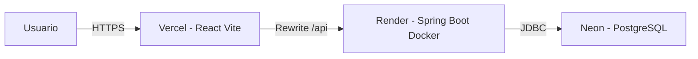

# Flowi

**Flowi** es una aplicación web para gestión de inventario y ventas en una red de tiendas y centros de distribución. Incluye autenticación con JWT y control de acceso por roles.

Demo (producción):

- Frontend: https://flowi-flax-eta.vercel.app  
- Backend: https://flowi-backend-4rks.onrender.com

---

## Contenido

1. [Características](#características)
2. [Roles y permisos](#roles-y-permisos)
3. [Arquitectura](#arquitectura)
4. [Tecnologías](#tecnologías)
5. [Requisitos previos](#requisitos-previos)
6. [Ejecución en local](#ejecución-en-local)
   - [Con Docker](#con-docker)
   - [Sin Docker](#sin-docker)
   - [Crear el primer usuario administrador](#crear-el-primer-usuario-administrador)
7. [Variables de entorno](#variables-de-entorno)
8. [API (endpoints)](#api-endpoints)
9. [Despliegue en la nube](#despliegue-en-la-nube)
10. [Pruebas](#pruebas)
11. [Limitaciones conocidas y próximos pasos](#limitaciones-conocidas-y-próximos-pasos)
12. [Capturas de pantalla](#capturas-de-pantalla)
13. [Autores](#autores)

---

## Características

### Inventario y catálogo
- Consulta de productos.
- Consulta de inventario por tienda (incluye vista “enriquecida” para UI).
- Identificación de productos con **stock bajo** (la UI calcula el estado en base a `quantity <= minimum`).

### Ventas
- Registro de ventas y descuento de inventario en una transacción (rollback si falta stock).

### Sedes
- Consulta de tiendas.
- Consulta de centros de distribución (en UI aparece como módulo solo para ADMIN).

### Autenticación y seguridad
- Inicio de sesión con usuario/contraseña.
- Autorización por roles con JWT.
- Cierre de sesión con lista de tokens revocados en memoria.

---

## Roles y permisos

Roles definidos en backend y frontend: `ADMIN`, `VENDEDOR`, `BODEGUERO`.

> Importante: según `SecurityConfig`, **todas las lecturas GET** para `stores`, `distribution-centers`, `products` e `inventory` son públicas (sin token). Las escrituras requieren token y rol.

| Módulo / Acción | ADMIN | VENDEDOR | BODEGUERO | Público |
|---|:---:|:---:|:---:|:---:|
| Iniciar sesión (`POST /api/auth/login`) | ✓ | ✓ | ✓ | ✓ |
| Cerrar sesión (`POST /api/auth/logout`) | ✓ | ✓ | ✓ | ✗ |
| Ver tiendas (`GET /api/stores`) | ✓ | ✓ | ✓ | ✓ |
| Ver centros de distribución (`GET /api/distribution-centers`) | ✓ | ✓ | ✓ | ✓ |
| Ver productos (`GET /api/products`) | ✓ | ✓ | ✓ | ✓ |
| Ver inventario por tienda (`GET /api/inventory/{storeId}` y variantes) | ✓ | ✓ | ✓ | ✓ |
| Registrar venta (`POST /api/sales`) | ✓ | ✓ | ✗ | ✗ |
| Ingresar stock (`POST /api/inventory`) | ✓ | ✗ | ✓ | ✗ |
| Ajustar inventario por tienda (`PUT /api/inventory/{storeId}`) | ✓ | ✗ | ✓ | ✗ |
| Crear productos/tiendas/centros (POST a esos recursos) | ✓ | ✗ | ✗ | ✗ |

Permisos visibles en la UI (frontend):
- Menú “Centros de distribución” solo se muestra a `ADMIN`.
- Botón “Ingresar stock” en tiendas solo se muestra a `ADMIN` y `BODEGUERO`.
- “Registrar venta” se muestra a cualquier rol autenticado, pero el backend exige `ADMIN` o `VENDEDOR`.

---

## Arquitectura

### Diagrama (alto nivel)



### Backend (arquitectura hexagonal)

Estructura principal (resumen):

```text
services/backend/src/main/java/com/example/demo1/
├── domain/                         # Entidades y reglas
│   ├── port/out/                   # Puertos de persistencia (interfaces)
│   └── exception/
├── application/service/            # Casos de uso / servicios de aplicación
└── infrastructure/
    ├── adapter/in/web/             # Controladores REST + DTOs
    ├── adapter/out/persistence/    # JPA entities, repositories e implementaciones de puertos
    └── security/                   # JWT, filtros, blacklist, SecurityConfig
```

---

## Tecnologías

> Versiones verificadas en el código del repo (pom.xml, package.json y Dockerfiles).

| Componente | Tecnología | Versión (verificada) |
|---|---|---|
| Backend | Spring Boot | 4.1.1 |
| Backend | Java (Temurin) | 26 |
| Seguridad | Spring Security | 6.5.3 (propiedad en pom.xml) |
| JWT | JJWT | 0.12.6 |
| BD | PostgreSQL | 16 (docker-compose) |
| Frontend | React | 19.0.0 |
| Frontend | React Router | 8.3.1 |
| Frontend | Vite | 8.0.5 |
| Frontend | TypeScript | 5.7.0 |
| Frontend | TailwindCSS | 4.0.0 |
| Runtime frontend build | Node | 22 (Dockerfile y .mise.toml) |
| Package manager | pnpm | 10.34.3 (.mise.toml) |
| Web server (frontend en Docker) | Nginx | 1.27 (alpine) |

Notas:
- `axios` figura como dependencia en `frontend/package.json` pero **no se usa** en `frontend/src` (las llamadas se hacen con `fetch`).

---

## Requisitos previos

### Para ejecutar con Docker
- Docker Desktop / Docker Engine con soporte para `docker compose`.

### Para ejecutar sin Docker
- Java 26 (o compatible con el proyecto).
- PostgreSQL 16+ (o compatible).
- Node 22 y pnpm.

---

## Ejecución en local

### Con Docker

Levanta base de datos, backend y frontend (Nginx):

```bash
docker compose up --build -d
```

Puertos en local (según `docker-compose.yml`):
- Frontend: http://localhost:3030
- Backend: http://localhost:8080

Notas:
- El frontend (Nginx) hace proxy de `/api/` hacia el backend (`frontend/nginx.conf`).
- La base de datos persiste en el volumen `demo1-postgres-data`.

### Sin Docker

#### 1) Base de datos (PostgreSQL local)

Crea una base de datos (ejemplo):

```sql
CREATE DATABASE demo1;
```

Configura variables para el backend (ver [Variables de entorno](#variables-de-entorno)).

> `data.sql` carga datos de ejemplo (productos/tiendas/centros/inventario) de forma idempotente.

#### 2) Backend (Spring Boot con Maven Wrapper)

**PowerShell (Windows):**

```powershell
cd services/backend
$env:SPRING_DATASOURCE_URL="jdbc:postgresql://localhost:5432/demo1"
$env:SPRING_DATASOURCE_USERNAME="postgres"
$env:SPRING_DATASOURCE_PASSWORD="postgres"
$env:JWT_SECRET="<JWT_SECRET_DE_AL_MENOS_32_BYTES>"
./mvnw.cmd spring-boot:run
```

**Bash (Linux/macOS):**

```bash
cd services/backend
export SPRING_DATASOURCE_URL="jdbc:postgresql://localhost:5432/demo1"
export SPRING_DATASOURCE_USERNAME="postgres"
export SPRING_DATASOURCE_PASSWORD="postgres"
export JWT_SECRET="<JWT_SECRET_DE_AL_MENOS_32_BYTES>"
./mvnw spring-boot:run
```

El backend corre por defecto en `http://localhost:8080` (propiedad `server.port=${PORT:8080}`).

#### 3) Frontend (Vite dev server)

En desarrollo, Vite hace proxy de `/api` hacia `http://localhost:8080` (ver `frontend/vite.config.ts`).

**PowerShell / Bash:**

```bash
cd frontend
corepack enable
pnpm install
pnpm dev
```

El puerto exacto del dev server puede variar (Vite lo muestra al iniciar).  
Si usas el proxy `/api`, no necesitas configurar `VITE_API_BASE_URL` en local.

### Crear el primer usuario administrador

No existe endpoint público de registro de usuarios. Debes insertar manualmente un usuario en la tabla `users` con contraseña en BCrypt.

1) Genera un hash BCrypt (ejemplo conceptual):

- Opción A (Java / Spring): usar `BCryptPasswordEncoder` en un snippet local.
- Opción B (CLI): cualquier herramienta confiable de BCrypt.

2) Inserta el usuario:

```sql
INSERT INTO users (username, password, role)
VALUES ('admin', '<HASH_BCRYPT>', 'ADMIN');
```

- Usa `<HASH_BCRYPT>` como placeholder: reemplázalo por el hash real antes de ejecutar.
- Roles válidos: `ADMIN`, `VENDEDOR`, `BODEGUERO`.

---

## Variables de entorno

> Seguridad: no incluyas valores reales (tokens, contraseñas, JWT_SECRET, JDBC reales de Neon). Usa placeholders.

### Backend (Spring Boot)

| Variable | Dónde se usa | Ejemplo (ficticio) | ¿Obligatoria? |
|---|---|---|:---:|
| `SPRING_DATASOURCE_URL` | `application.properties` (`spring.datasource.url`) | `jdbc:postgresql://localhost:5432/demo1` | No (tiene default) |
| `SPRING_DATASOURCE_USERNAME` | `application.properties` | `postgres` | No (tiene default) |
| `SPRING_DATASOURCE_PASSWORD` | `application.properties` | `postgres` | No (tiene default) |
| `JWT_SECRET` | `application.properties` (`jwt.secret`) + `JwtTokenService` | `<JWT_SECRET_DE_AL_MENOS_32_BYTES>` | **Sí** |
| `JWT_EXPIRATION_MS` | `application.properties` (`jwt.expiration-ms`) | `3600000` | No (default 3600000) |
| `FRONTEND_ORIGIN` | `CorsConfig` | `https://flowi-flax-eta.vercel.app` | No (default `http://localhost:3030`) |
| `PORT` | `application.properties` (`server.port`) | `8080` | No (default 8080; en Render lo asigna la plataforma) |

### Frontend (Vite / Vercel)

| Variable | Dónde se usa | Ejemplo (ficticio) | ¿Obligatoria? |
|---|---|---|:---:|
| `VITE_API_BASE_URL` | `frontend/src/services/api.ts` (solo login/logout) | `https://flowi-backend-4rks.onrender.com` | No (default `http://localhost:8080`) |

Notas importantes:
- La mayoría de llamadas del frontend usan rutas relativas `/api/...` (helper `apiFetch`), por lo que dependen de:
  - proxy de Vite en local, o
  - `rewrites` en Vercel (`frontend/vercel.json`), o
  - proxy de Nginx en Docker (`frontend/nginx.conf`).

---

## API (endpoints)

Fuente: controladores en `services/backend/src/main/java/.../infrastructure/adapter/in/web` y reglas en `SecurityConfig`.

| Método | Ruta | Requiere token | Rol requerido (según backend) | Descripción |
|---|---:|:---:|---|---|
| `POST` | `/api/auth/login` | No | Público | Inicia sesión. Devuelve `{ token, role }`. |
| `POST` | `/api/auth/logout` | Sí | Cualquier autenticado | Revoca el token actual en memoria (TokenBlacklist). |
| `GET` | `/api/stores` | No | Público | Lista tiendas. |
| `POST` | `/api/stores` | Sí | `ADMIN` | Registra tienda. |
| `GET` | `/api/distribution-centers` | No | Público | Lista centros de distribución. |
| `POST` | `/api/distribution-centers` | Sí | `ADMIN` | Registra centro de distribución. |
| `GET` | `/api/products` | No | Público | Lista productos. |
| `POST` | `/api/products` | Sí | `ADMIN` | Registra producto (incluye `category`, `unit`, `minimumStock`). |
| `GET` | `/api/inventory/{storeId}` | No | Público | Inventario básico por tienda. |
| `GET` | `/api/inventory/{storeId}/enriched` | No | Público | Inventario enriquecido para UI (`id,name,sku,category,detail,price,quantity,minimum`). |
| `GET` | `/api/inventory/{storeId}/low-stock?threshold=10` | No | Público | Inventario bajo por tienda (`threshold` default 10). |
| `PUT` | `/api/inventory/{storeId}` | Sí | `ADMIN`, `BODEGUERO` | Ajusta/crea la cantidad de un producto en una tienda. |
| `POST` | `/api/inventory` | Sí | `ADMIN`, `BODEGUERO` | Ingresa stock (suma cantidad existente o crea fila). |
| `POST` | `/api/sales` | Sí | `ADMIN`, `VENDEDOR` | Registra venta y descuenta stock (transaccional). |
| `GET` | `/api/hello` | Sí | `ADMIN` | Endpoint de prueba (no está permitido públicamente por SecurityConfig). |

---

## Despliegue en la nube

Resumen (verificado en config del repo):

- **Neon (PostgreSQL):** base de datos en la nube usada por el backend.
  - `SPRING_DATASOURCE_URL` debe ser una URL JDBC válida.
  - <!-- TODO: confirmar si se requiere `sslmode=require` en el entorno actual de Neon -->

- **Render (backend, Docker):**
  - Root Directory: `services/backend`
  - Dockerfile: `services/backend/Dockerfile`
  - Variables: `SPRING_DATASOURCE_URL`, `SPRING_DATASOURCE_USERNAME`, `SPRING_DATASOURCE_PASSWORD`, `JWT_SECRET`, opcionales `JWT_EXPIRATION_MS`, `FRONTEND_ORIGIN`.
  - `PORT` lo gestiona Render.

- **Vercel (frontend):**
  - Root Directory: `frontend`
  - Rewrites: `frontend/vercel.json` reescribe `/api/*` hacia `https://flowi-backend-4rks.onrender.com/api/*`.

Si necesitas un paso a paso más detallado:
- <!-- TODO: crear docs/DESPLIEGUE.md si el equipo lo requiere (por ahora el README contiene el resumen) -->

---

## Pruebas

Backend:
- Unit tests con Mockito:
  - `ProductServiceTest`, `StoreServiceTest`, `DistributionCenterServiceTest`.
- `Demo1ApplicationTests` (`@SpringBootTest`) levanta el contexto completo, por lo que requiere:
  - una base de datos accesible, y
  - `JWT_SECRET` definido.

Ejecutar tests (backend):

**PowerShell:**

```powershell
cd services/backend
$env:JWT_SECRET="<JWT_SECRET_DE_AL_MENOS_32_BYTES>"
./mvnw.cmd test
```

**Bash:**

```bash
cd services/backend
export JWT_SECRET="<JWT_SECRET_DE_AL_MENOS_32_BYTES>"
./mvnw test
```

Frontend:
- No hay tests automatizados en el repo actualmente.

---

## Limitaciones conocidas y próximos pasos

Limitaciones verificadas:
- El logout usa una blacklist en memoria (`TokenBlacklist`): los tokens revocados **se pierden** al reiniciar y no se comparten entre múltiples instancias.
- En despliegues gratuitos de Render/Neon puede haber **latencia inicial** por inactividad (cold start).

Mejoras sugeridas (observadas en el código):
- Centralizar el consumo de API en el frontend: hoy `login/logout` usan `API_BASE_URL` y el resto usa rutas relativas `/api`.
- Mejorar eficiencia en `SaleService`: el precio del producto se obtiene buscando en `productRepository.findAll()` por cada item (se podría optimizar con lookup por id).
- Agregar pruebas de integración/API y pipeline CI.
- Revisar y documentar mejor el manejo de migraciones (hoy `ddl-auto=update` + script manual opcional `db-migration-manual.sql`).

---

## Capturas de pantalla

No se incluyen capturas en este repo.

Sugerencias de pantallas a documentar (agregar imágenes en `docs/img/`):
- <!-- TODO: Login -->
- <!-- TODO: Inventario por tienda -->
- <!-- TODO: Registrar venta -->
- <!-- TODO: Productos con stock bajo (Disponibilidad) -->

---

## Autores

Según historial de git:
- Diego Alejandro Osorio Jimenez
- Juliana Calderon
- AlejandroOsorio17
